## Main skills

**Mainframe IBM z/OS**

**Sviluppo e strumenti**

## Studying

Linux (EndeavourOS), Generative AI con Google Skills e il percorso IBM Z Xplore.

## Certificazioni

Tutti i miei badge verificati sono su Credly.

## Portfolio

- 🖥️ [**z-OS-Portfolio**](https://github.com/GS-DotCom/z-OS-Portfolio): esercizi e job reali su z/OS (JCL, DFSORT, REXX, DB2)
- 🌐 [**Web Portfolio**](https://giuliano-simone.vercel.app/): il mio sito personale

## Connect with me!

## Recruiter?

**Importante:** sono disponibile per ruoli da **sviluppatore** o **sistemista** a Roma, in sede, ibrido o da remoto.
📄 [Scarica il mio CV](https://github.com/GS-DotCom/Curriculum_Vitae)

